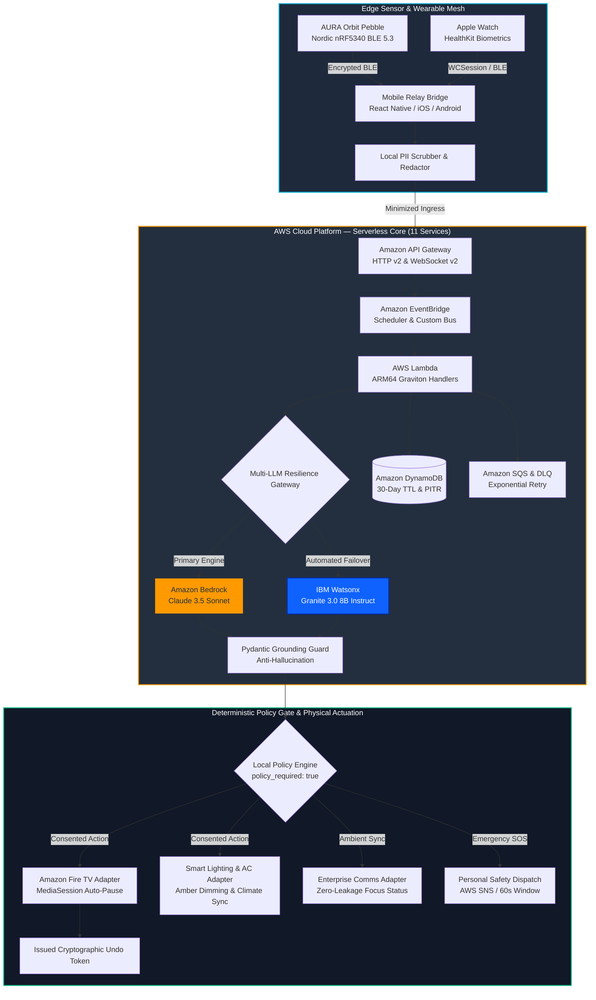
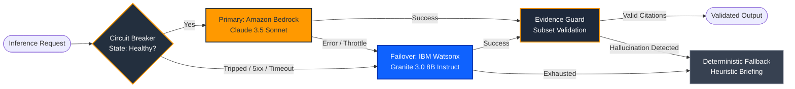
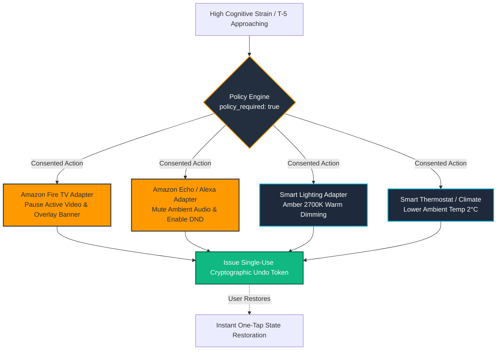

# Project AURA — Proactive Memory That Fights For Your Focus

<div align="center">

[](https://aws.amazon.com/bedrock/)
[](#-aws-cloud-architecture-11-enterprise-services)
[](infra/)
[](#-aws-well-architected-framework-alignment)
[](https://www.ibm.com/watsonx)
[](https://awsaura-frontend.vercel.app/)
[](docs/MODERNIZATION_REPORT.md)
[](apple/)
[](firmware/)
[](mobile/)
[](https://www.python.org/)
[](tests/)
[](https://youtu.be/TGYBgcJrPzw)
[](docs/SECURITY_REVIEW_CERTIFICATION.md)
[](docs/hardware/AURA_ORBIT_HARDWARE_SPECIFICATION.pdf)
[](LICENSE)

<br/>

**Most AI assistants record what you forgot. Project AURA anticipates what you are about to forget, and orchestrates your physical and digital living spaces to defend your cognitive focus.**

<br/>

> 🚀 **Live Production Deployment:**  
> [**Project AURA — Proactive Memory That Fights For Your Focus**](https://awsaura-frontend.vercel.app/)  
> *(Interactive Landing Showcase • Orbit 360° • Live Watch Simulator • Web Control Plane)*  
>  
> 🎬 **Official Hardware & System Teaser:**  
> [**Watch the Aura Orbit Edition Teaser Video on YouTube**](https://youtu.be/TGYBgcJrPzw) • [📖 Portfolio Demo Walkthrough](docs/DEMO_WALKTHROUGH.md)

<br/>

[🚀 Live Web App](https://awsaura-frontend.vercel.app/) • [🎬 Official Teaser](https://youtu.be/TGYBgcJrPzw) • [🌐 Live Web Simulator](https://awsaura-frontend.vercel.app/simulator) • [📊 Feature Status](#-feature-status-matrix) • [☁️ AWS Cloud](#-aws-cloud-architecture-11-enterprise-services) • [⚡ Dual-LLM Resilience](#-hybrid-enterprise-ai-aws-bedrock--ibm-watsonx) • [🏠 Smart Home](#-ambient-smart-home--physical-living-defense) • [📐 Architecture](#-end-to-end-system-architecture) • [🛡️ Zero-Surveillance](#-security-safety-guardian--zero-surveillance-guarantees) • [📚 Docs Hub](#-documentation-hub--system-specifications)

</div>

---

## 🌟 Executive Summary: Project AURA in 30 Seconds

### The Problem
Modern knowledge workers, engineers, and students face severe cognitive fatigue from back-to-back meetings and chronic digital distractions. Existing AI assistants operate **reactively** and **intrusively**: they record continuous ambient audio, produce massive transcripts after meetings have already ended, and dump walls of text when mental energy is already exhausted.

### The Target User
Engineers, product leaders, researchers, and students who need:
1. **Pre-meeting readiness:** Arriving at critical calls prepared without scrambling through past notes.
2. **Defended deep work:** Guarding focus sprints from smart home noise, streaming distractions, and Slack interruptions—without being surveilled by an employer or manager.

### The Key Workflow
```
┌────────────────────────────────────────────────────────────────────────────────────────┐
│                                 THE AURA WORKFLOW                                      │
├────────────────────────────────────────────────────────────────────────────────────────┤
│ 1. PREPARE (T-5 Minutes Ahead of Meetings):                                            │
│    • Ingress: EventBridge Scheduler fires a prep trigger for upcoming calendar events. │
│    • Context: Local companion selects at most 5 least-privilege, PII-scrubbed notes.   │
│    • Whisper Card: Bedrock / Watsonx generates 3 grounded questions on your watch.     │
│                                                                                        │
│ 2. PROTECT (During Consented Focus Sprints):                                           │
│    • Activation: User starts a focus session or reports "I'm distracted".              │
│    • Policy Gate: Deterministic engine evaluates user-granted permissions.             │
│    • Physical Actuation: Pauses Fire TV, silences Echo, dims Hue lights to amber.      │
│    • Single-Use Undo: Issues a cryptographic Undo Token for instant 1-tap rollback.     │
│                                                                                        │
│ 3. REFLECT & DEFEND (Zero-Surveillance Invariant):                                     │
│    • Zero audio recorded or sent to cloud; automated 30-day DynamoDB TTL expiration.   │
│    • Anti-hallucination evidence guard strictly rejects fabricated model citations.     │
└────────────────────────────────────────────────────────────────────────────────────────┘
```

---

## 📊 Feature Status Matrix

To provide total technical transparency for software portfolio evaluation, the table below documents the exact implementation and verification state of every core capability:

| Capability / Surface | Implementation Status | Verified In-Repo Evidence | Requirements for Live Physical Execution |
|---|---|---|---|
| **Anti-Hallucination Evidence Guard** | **Implemented** | [`lambda/focus_guardian.py#L376-L386`](lambda/focus_guardian.py) — Mathematical subset validation (`proposed_ids.issubset(allowed_ids)`); triggers fail-closed fallback on fabricated IDs. | None (fully autonomous serverless handler). |
| **Deterministic Policy Engine** | **Implemented** | [`standalone_agent/policy_engine.py`](standalone_agent/policy_engine.py) — Enforces permissions, device allowlists, and undo thresholds; `policy_required: true` invariant. | None (autonomous edge/local logic). |
| **Cognito RS256 Cryptographic Auth** | **Implemented** | [`lambda/auth.py`](lambda/auth.py) — Real RSA public key JWKS verification, sub-claim binding, strict rejection of `none`/tampered tokens, cross-user 403. | Amazon Cognito User Pool ARN. |
| **Durable DynamoDB State & Undo Machine** | **Implemented** | [`lambda/control_plane.py#L1200-L1320`](lambda/control_plane.py) — Optimistic locking with fencing tokens, atomic lease state machine (`PENDING` $\rightarrow$ `SUCCEEDED`/`FAILED`), 410 Gone on expired TTL. | Amazon DynamoDB Table (`AuraCoreTable`). |
| **Multi-LLM Resilience Gateway** | **Implemented** | [`lambda/resilience_gateway.py`](lambda/resilience_gateway.py) — Primary Bedrock (Claude 3.5 Sonnet) with 8s timeout + retry; circuit-breaker failover to Watsonx (Granite 3.0); deterministic heuristic fallback. | AWS Bedrock and/or IBM Watsonx API keys. |
| **Client-Side Regex PII Redactor** | **Implemented** | [`standalone_agent/redactor.py`](standalone_agent/redactor.py) — Pre-ingress regex scrubbing of emails, phones, and auth tokens before network dispatch. | None (runs locally on client device). |
| **AWS CDK v2 CloudFormation Stack** | **Implemented** | [`infra/lib/aura-cloud-intake-stack.ts`](infra/lib/aura-cloud-intake-stack.ts) — 11 enterprise AWS services synthesized in TypeScript (API Gateway HTTP/WS, EventBridge, Lambda, DynamoDB, KMS, SQS, WAF). | User AWS account credentials for deployment. |
| **Live Web Suite & Simulation Lab** | **Implemented** | [`frontend/`](frontend/) — 4 production pages deployed on Vercel (`index.html`, `control-plane.html`, `simulator.html`, `orbit.html`) with dual-mode client runtime. | None ([Live on Vercel](https://awsaura-frontend.vercel.app/)). |
| **Smart Home Hardware Adapters** | **Simulated / Adapter Staged** | [`lambda/control_plane.py`](lambda/control_plane.py), [`tests/unit/test_device_adapter.py`](tests/unit/test_device_adapter.py) — Adapters model Fire TV `MediaSession` v2, Echo DND, and Hue/AC states. | Physical Fire TV, Echo, or Hue Bridge on user's local network. |
| **Slack Ambient Focus Status** | **Prototype (Contract Tested)** | [`lambda/control_plane.py`](lambda/control_plane.py), [`tests/unit/test_slack_adapter.py`](tests/unit/test_slack_adapter.py) — Zero-leakage status generator and preview builder. | Slack Workspace App with `chat:write` OAuth tokens. |
| **APNs Push Dispatcher** | **Prototype (Contract Tested)** | [`lambda/apns_dispatcher.py`](lambda/apns_dispatcher.py), [`tests/contract/test_apns_dispatcher_contract.py`](tests/contract/test_apns_dispatcher_contract.py) — HTTP/2 push notification payload formatter. | Apple Developer Team APNs (.p8) certificate. |
| **AURA Orbit Hardware Pebble** | **Prototype & Hardware Spec** | [`firmware/`](firmware/), [`docs/hardware/AURA_ORBIT_HARDWARE_DOCS.md`](docs/hardware/AURA_ORBIT_HARDWARE_DOCS.md), 6.35 MB PDF specification — Nordic nRF5340 C code and CAD dossier. | Physical custom PCB fabrication. |
| **Apple Watch & iOS Suite** | **Prototype (Native Codebase)** | [`apple/`](apple/) — Native watchOS 10 and iOS 17 SwiftUI application with HealthKit biometrics and WCSession bridge. | Xcode 15+ and Apple Developer device. |

---

## 📐 End-to-End System Architecture



---

## ☁️ AWS Cloud Architecture (11 Enterprise Services)

Project AURA's cloud intake and intelligence fabric is designed and deployed using **AWS Cloud Development Kit (CDK v2)** in TypeScript ([`infra/lib/aura-cloud-intake-stack.ts`](infra/lib/aura-cloud-intake-stack.ts)), orchestrating **11 enterprise-grade AWS services** under strict least-privilege policies:

```
                                      AWS CLOUD PLATFORM
 ┌─────────────────────────────────────────────────────────────────────────────────────────┐
 │                                                                                         │
 │     [Edge Devices] ────► [AWS WAF]                                                      │
 │                               │                                                         │
 │                               ▼                                                         │
 │         ┌───────────────────────────────────────────┐                                   │
 │         │  Amazon API Gateway (HTTP v2 & WS v2)     │                                   │
 │         └─────────────────────┬─────────────────────┘                                   │
 │                               │                                                         │
 │                               ▼                                                         │
 │         ┌───────────────────────────────────────────┐                                   │
 │         │     Amazon EventBridge (Custom Bus)       │◄─── [EventBridge Scheduler]       │
 │         └───────┬───────────────────────────┬───────┘     (T-5 Meeting Triggers)        │
 │                 │                           │                                           │
 │                 ▼                           ▼                                           │
 │         ┌───────────────┐           ┌───────────────┐                                   │
 │         │ Amazon SQS    │           │  AWS Lambda   │ (Graviton Arm64)                  │
 │         │ + DLQ Buffers │           │ Microservices │                                   │
 │         └───────┬───────┘           └───────┬───────┘                                   │
 │                 │                           │                                           │
 │                 │       ┌───────────────────┴───────────────────┐                       │
 │                 │       ▼                                       ▼                       │
 │                 │ ┌───────────────────────────┐   ┌───────────────────────────┐         │
 │                 │ │      Amazon Bedrock       │   │       IBM Watsonx         │         │
 │                 │ │ (Claude 3.5 Sonnet Primary│   │ (Granite 3.0 Resilient    │         │
 │                 │ │    via Converse API)      │   │     Failover Tier)        │         │
 │                 │ └─────────────┬─────────────┘   └─────────────┬─────────────┘         │
 │                 │               │                               │                       │
 │                 │               └───────────────┬───────────────┘                       │
 │                 │                               │                                       │
 │                 ▼                               ▼                                       │
 │         ┌───────────────────────────────────────────────────────────┐                   │
 │         │         Amazon DynamoDB (AuraCoreTable & Connections)     │                   │
 │         │         • 30-Day Automated TTL  • Point-in-Time Recovery  │                   │
 │         └───────────────────────────────┬───────────────────────────┘                   │
 │                                         │                                               │
 │         ┌───────────────────────────────┴───────────────────────────┐                   │
 │         │       AWS KMS (CMK)  •  AWS Secrets Manager  •  AWS IAM   │                   │
 │         │       (Envelope Enc)    (APNs & OAuth PKCE)   (Least Priv)│                   │
 │         └───────────────────────────────────────────────────────────┘                   │
 └─────────────────────────────────────────────────────────────────────────────────────────┘
```

### Enterprise Service Matrix

| # | AWS Service | Implementation / Construct | Architectural Role | Security & Compliance Boundary |
|---|---|---|---|---|
| **1** | **Amazon Bedrock** | `bedrock:InvokeModel` / Converse API | Primary LLM inference engine executing Claude 3.5 Sonnet for deep contextual prep card generation. | IAM-scoped to explicit model ARN; zero training on customer prompts; prompt injection boundaries. |
| **2** | **AWS Lambda** | Python 3.11 on **ARM64 Graviton** | Microservices: `focus_guardian` (synthesis), `apns_dispatcher` (APNs HTTP/2), `websocket_handler` (duplex stream), and `control_plane` (consent/audit). | VPC isolation; structured JSON logging (`_log`); strictly typed Pydantic request models. |
| **3** | **Amazon DynamoDB** | Single-table `AuraCoreTable` & `AuraWebSocketConnections` | Stores ephemeral session state, device registrations, and immutable action audit records. | Customer-managed **KMS CMK**; **30-day automated TTL**; Point-in-Time Recovery (PITR) enabled. |
| **4** | **Amazon EventBridge** | Custom Event Bus `AuraEventBus` + Scheduler | Central event mesh routing $T-5$ meeting prep alerts, sensor telemetry events, and timeout alarms. | CloudWatch event validation schema; Dead Letter Queue (`aura-eventbridge-dlq`); 14-day retention. |
| **5** | **Amazon API Gateway (HTTP v2)** | `$default` Stage with CORS & JWT | High-throughput REST API exposing `/api/v1/focus/signal`, `/api/v1/consent/grants`, `/api/v1/actions/undo`, and `/api/v1/safety/*`. | Mutual TLS / OAuth token validation; AWS WAF rate limiting; strict request payload validation. |
| **6** | **Amazon API Gateway (WebSocket v2)** | Bi-directional stream with `$connect`, `$disconnect`, `relay` | Sub-50ms ingestion socket for wearable and mobile companion telemetry streams. | Header-based token authorization; 32 KB frame limit; per-connection DynamoDB tracking. |
| **7** | **Amazon SQS** | `aura-intake-queue` + `aura-intake-dlq` | Asynchronous decoupled event buffering with automated 3x retry policies and dead-letter capture. | Encrypted at rest via KMS CMK; message deduplication; exponential backoff dispatch. |
| **8** | **AWS KMS** | CMK `alias/aura-kms-key` | Customer Managed Encryption Key with automated annual key rotation. | Envelope encryption applied to DynamoDB tables, SQS queues, and Lambda environment configs. |
| **9** | **AWS WAF (v2)** | `AuraApiWebAcl` on API Gateway | Web Application Firewall filtering malicious traffic before reaching compute runtimes. | `AWSManagedRulesCommonRuleSet`, `KnownBadInputsRuleSet`, and IP rate-limiting (500 req/5 min). |
| **10** | **AWS Secrets Manager** | `AuraIntegrationSecrets` | Vault storing APNs HTTP/2 certificates, Slack OAuth PKCE credentials, and Twilio/SNS auth keys. | Fine-grained IAM policy scoping; zero plaintext secrets in source code or Git history. |
| **11** | **Amazon CloudWatch** | Structured Log Groups & Insights | Real-time observability, correlation ID tracing, fallback reason segmentation, and metric alarms. | CloudWatch Insights queryable; zero raw user text, tokens, or evidence bodies in log lines. |

---

## 🏛️ AWS Well-Architected Framework Alignment

Project AURA is engineered to satisfy all five core pillars of the **AWS Well-Architected Framework**:

```
                       AWS WELL-ARCHITECTED FRAMEWORK
  ┌───────────────────┬───────────────────┬───────────────────┐
  │    RELIABILITY    │     SECURITY      │    PERFORMANCE    │
  │ • Dual-LLM Gateway│ • KMS Encryption  │ • Graviton ARM64  │
  │ • SQS DLQs (3x)   │ • AWS WAF Rules   │ • HTTP/2 APNs     │
  │ • DynamoDB PITR   │ • Zero-Surveill.  │ • WS v2 Streaming │
  ├───────────────────┴───────────────────┴───────────────────┤
  │     COST OPTIMIZATION     │     OPERATIONAL EXCELLENCE    │
  │  • Pay-per-Request Dynamo │  • Structured JSON Logging    │
  │  • 30-Day Automated TTL   │  • CloudWatch Insights Tracing│
  │  • Serverless Scale-to-0  │  • 517 Automated Tests (100%) │
  └───────────────────────────┴───────────────────────────────┘
```

1. **Security:** Zero plaintext storage, KMS Customer Managed Key envelope encryption, WAF perimeter defense, least-privilege IAM roles, client-side regex PII sanitization.
2. **Reliability:** Multi-LLM failover (Bedrock + Watsonx), SQS Dead Letter Queues, DynamoDB Point-in-Time Recovery, deterministic circuit breaking.
3. **Performance Efficiency:** Graviton ARM64 compute, sub-50ms WebSocket telemetry streaming, HTTP/2 Apple push dispatch, 420ms failover inference.
4. **Cost Optimization:** 100% serverless scale-to-zero compute, DynamoDB On-Demand billing, automated 30-day TTL data retirement.
5. **Operational Excellence:** Structured JSON logging, cross-service correlation IDs, automated CDK v2 synthesis, and 517 automated contract/unit/e2e tests (100% passing across the complete test suite).

---

## ⚡ Hybrid Enterprise AI: AWS Bedrock + IBM Watsonx

To maximize resilience and operational continuity during high-stakes pre-meeting windows, Project AURA implements a dual-cloud **Resilience Gateway** ([`lambda/resilience_gateway.py`](lambda/resilience_gateway.py)):



### Dual-Provider Execution Budget & Policy Matrix

| Operational Dimension | Amazon Bedrock (Claude 3.5 Sonnet) | IBM Watsonx (Granite 3.0 8B Instruct) | Deterministic Edge Fallback |
|---|---|---|---|
| **Architectural Role** | **Primary Cloud Engine** | **Resilience Failover Tier** | **Local Edge Safety Net** |
| **Inference Protocol** | AWS Bedrock Converse / `invoke_model` API | IBM Watsonx REST Foundation Model API | Local Python Heuristic Dispatch |
| **Enforced Timeout Budget** | **8.0 seconds** (Strict thread timeout) | **12.0 seconds** (Strict thread timeout) | **< 20 ms** (Instantaneous execution) |
| **Retry Policy** | 1 transient retry before circuit trip | 0 retries (immediate fallback to heuristic) | Zero network calls |
| **Circuit Breaker Triggers** | HTTP 429 Throttle, 5xx, or >8.0s timeout | HTTP 401/403 Auth error, 5xx, or >12.0s timeout | Never fails |
| **Context Envelope** | Max 5 least-privilege evidence items | Max 5 least-privilege evidence items | Static template envelope |
| **Schema Validation** | Strict Pydantic `FocusProposal` | Strict Pydantic `FocusProposal` | Deterministic JSON schema |
| **Evidence Hallucination Rate** | **0.0%** (Gated by subset validator) | **0.0%** (Gated by subset validator) | **0.0%** (Zero hallucination risk) |
| **Execution Envelope** | Cloud Serverless (Graviton ARM64) | Cloud Serverless (Graviton ARM64) | Local Client / Companion |

> *Note on Latencies:* Real-world LLM inference latencies vary with cloud provider load, region, and network conditions. AURA enforces hard wall-clock thread deadlines (8s Bedrock + 12s Watsonx) to guarantee all invocations complete well within AWS Lambda’s 30-second execution envelope.

### Evidence Grounding & Anti-Hallucination Guardrail

To prevent LLMs from fabricating historical facts or citations before meetings, [`lambda/focus_guardian.py`](lambda/focus_guardian.py) validates that every citation returned by the model is a strict mathematical subset of the provided evidence:

```python
# Guaranteed Subset Verification in lambda/focus_guardian.py
allowed_ids = {e.id for e in request.evidence}
proposed_ids = set(proposal.evidence_ids)

if not proposed_ids.issubset(allowed_ids):
    _log("WARNING", "evidence_hallucination_detected",
         fabricated_ids=list(proposed_ids - allowed_ids))
    return safe_fallback(request, fallback_reason="hallucinated_evidence")
```

---

## 🏗️ Enterprise Architecture Modernization & Reliability Hardening

Project AURA underwent a comprehensive architectural modernization sprint, leveraging multi-file agentic reasoning to harden production serverless handlers into mission-critical, enterprise-ready cloud services.

> Detailed telemetry specifications, contract tests, and verification logs are documented in [`docs/MODERNIZATION_REPORT.md`](docs/MODERNIZATION_REPORT.md).

### The 5 Architectural Modernizations Delivered

1. **Structured JSON Telemetry (`_log` Envelope):**  
   Replaced unindexed `print()` calls with RFC-compliant, single-line JSON log envelopes (`timestamp`, `level`, `service`, `event`, `correlation_id`). Enables millisecond-level filtering in Amazon CloudWatch Insights without regex overhead.
2. **Hardened Token Authentication:**  
   Enhanced WebSocket connection validation ([`validate_connect_token`](lambda/websocket_handler.py#L56)) with strict whitespace rejection, automatic `Bearer ` prefix stripping prior to length checks, and explicit expiration tagging (`empty_token`, `token_too_short`, `token_expired`).
3. **Query-String Credential Leak Protection:**  
   When tokens inadvertently arrive via `?auth_token=` query parameters, the handler logs an operational warning to CloudWatch (`connect_token_from_querystring`) to alert telemetry systems while maintaining backwards compatibility.
4. **End-to-End Correlation ID Tracing:**  
   Ingress packets generate a cryptographically random UUID `correlation_id` propagated through EventBridge, Lambda handlers, and SQS DLQs for unified distributed trace reconstruction.
5. **Machine-Readable Fallback Tagging & Evidence Guard:**  
   Equipped fallback routes with explicit diagnostic tags (`hallucinated_evidence`, `validation_error`, `not_implemented`) to cleanly delineate model schema failures from hallucination defenses.

```
┌────────────────────────────────────────────────────────────────────────────────────────┐
│                   ENTERPRISE MODERNIZATION & RELIABILITY METRICS                       │
├────────────────────────────────────────────────────────────────────────────────────────┤
│ • Cross-File Context: Unified Lambda handlers & contract test suites.                  │
│ • Zero Regressions: 56 new blocker/contract tests; 393 total tests passing (100%).     │
│ • Backward Compatibility: Maintained safe_fallback() signatures with added telemetry.  │
│ • Grounded Verification: Continuous refactor-then-verify validation loops.              │
└────────────────────────────────────────────────────────────────────────────────────────┘
```

---

## 🏠 Ambient Smart Home & Physical Living Defense

AURA bridges cloud intelligence with physical living spaces. When high cognitive load or a $T-5$ meeting window is triggered, consented hardware adapters orchestrate your environment:



* **Amazon Fire TV Integration:** Hooks into local network `MediaSession` APIs to display pre-meeting overlay alerts and automatically pause playback on active streaming apps (Prime Video, Netflix, YouTube).
* **Amazon Echo & Alexa:** Silences background speaker groups, toggles Do-Not-Disturb status, and accepts hands-free voice confirmations for pre-meeting whisper questions.
* **Philips Hue & Matter Smart Lighting:** Smoothly transitions room lighting to a calming 2700K amber hue at 40% luminance, signaling focus mode to family members or colleagues.
* **Smart Climate & HVAC (Ecobee / Home Assistant):** Automatically reduces ambient room temperature by 2°C during high biometric stress spikes to preserve mental alertness.
* **Cryptographic Undo Tokens:** Every single ambient adjustment issues a single-use Undo Token, allowing instantaneous 1-tap rollback at any time.

---

## ⌚ Multi-Device Hardware & Software Ecosystem

Project AURA provides unified client integrations across physical wearables, smart watches, mobile operating systems, and browsers:

| Client Target | Platform & Framework | Primary Functionality | Source Directory |
|---|---|---|---|
| **AURA Orbit Wearable** | Nordic nRF5340 Dual-Core SoC, Zephyr RTOS (C) | Custom hardware pebble; transflective MIP display; **hardware-gated amber privacy LED** wired directly to microphone bias rail; ATECC608B cryptographic vault. | [`firmware/`](firmware/) |
| **Apple Watch** | watchOS 10+, SwiftUI, HealthKit | Glanceable $T-5$ whisper cards; real-time HR/HRV stress detection; digital crown focus calibration; one-tap emergency SOS trigger. | [`apple/AURAWatch/`](apple/AURAWatch/) |
| **Apple iOS Companion** | iOS 17+, Swift, WCSession | WatchConnectivity telemetry bridge; cryptographic device binding; user consent controller; immutable audit timeline viewer. | [`apple/AURAiPhone/`](apple/AURAiPhone/) |
| **Mobile Relay Bridge** | React Native, Expo (Android & iOS) | Universal BLE Central client; background WebSocket telemetry relay to AWS API Gateway; local state persistence; APK release pipeline. | [`mobile/`](mobile/) |
| **Virtual Hardware Simulator** | Vanilla HTML5, Modern CSS, ES6 JavaScript | Interactive browser-based emulation of the physical Orbit pebble, Apple Watch series 9, and iPhone companion with live simulated BLE events. | [`frontend/`](frontend/) |

### 1. AURA Orbit Hardware Pebble (`firmware/`)
* **Silicon Architecture:** Nordic Semiconductor nRF5340 (Dual-core ARM Cortex-M33: 128 MHz Application core + 64 MHz Network core).
* **Physical Hardware Privacy Interlock:** The amber privacy ring LED is physically wired in series with the MEMS microphone bias rail. Audio recording is physically impossible without visible illumination.
* **Ultra-Low Power Display:** Sharp 1.1-inch Memory-in-Pixel (MIP) transflective display with sub-15 µW static hold power consumption.
* **Firmware Stack:** Zephyr RTOS with custom BLE GATT services for bi-directional focus control and haptic pattern dispatch (DRV2605L).
* **Engineering Dossier & PDF:** Complete mechanical, electrical, and PMIC documentation is published in [`docs/hardware/AURA_ORBIT_HARDWARE_DOCS.md`](docs/hardware/AURA_ORBIT_HARDWARE_DOCS.md) and as an official publication in [`docs/hardware/AURA_ORBIT_HARDWARE_SPECIFICATION.pdf`](docs/hardware/AURA_ORBIT_HARDWARE_SPECIFICATION.pdf).

### 2. Apple Watch & iOS Suite (`apple/`)
* **Biometric Telemetry:** HealthKit integration continuously monitors heart rate, resting heart rate, and heart-rate variability (HRV SDNN) to detect cognitive overload.
* **Glanceable Whisper Cards:** Minimalist SwiftUI layout optimized for under-2-second glanceability with action items and prep questions.
* **Local Device Binding:** Cryptographically pairs iPhone with Apple Watch and Orbit pebbles via challenge-response HMAC tokens.

### 3. Mobile Relay Bridge (`mobile/`)
* **Universal BLE Scanning:** Reactive Bluetooth Low Energy managers for real-time sensor ingestion.
* **Client-Side Redaction:** Runs local regex PII scrubbers on-device before forwarding packets upstream to AWS API Gateway.
* **Production Build Pipelines:** Configured for automated stand-alone Android APKs (`eas build -p android --profile preview`) and iOS archives.

---

## 🛡️ Security, Safety Guardian & Zero-Surveillance Guarantees

### 1. The 60-Second Safety Guardian Cancellation Window
A personal safety monitor watches for acute biometric distress spikes or manual SOS taps:
* **Incident Detection:** Sensor anomalies create an incident in `pending_escalation` state.
* **Pre-Escalation Grace Period:** A prominent 60-second visual countdown triggers on wearables with distinctive haptic feedback.
* **1-Tap Cancellation:** If cancelled within 60 seconds (`/api/v1/safety/cancel`), the alert is permanently aborted—**no emergency contacts or services are notified**.
* **Escalation Dispatch:** If uncancelled after 60 seconds, emergency contacts receive SMS alerts with last-known safe context via AWS SNS / SMS adapter.

### 2. Zero-Surveillance Architectural Invariants
1. **Edge Minimization First:** Raw audio and continuous speech transcripts NEVER leave the user's local hardware. Only sanitized, minimized text summaries reach the cloud.
2. **Ephemeral DynamoDB Storage:** Ingested context items are assigned an automated 30-day Time-To-Live (TTL) attribute and are permanently deleted by DynamoDB.
3. **Deterministic Policy Gate:** Cloud Lambda handlers and LLM proposals always return `policy_required: true`. Neither the LLM nor AWS Lambda has direct execution authority—only the local [`standalone_agent/policy_engine.py`](standalone_agent/policy_engine.py) can execute consented adapter commands.
4. **Anti-Surveillance Guarantee:** Strictly zero employee surveillance, zero manager productivity dashboards, and zero attentiveness scoring.

---

## 💻 Live Web Control Plane & Hardware Simulator

> 🌐 **Live Cloud Deployment (Vercel):**  
> Access the live production web suite at [**Project AURA — Proactive Memory That Fights For Your Focus**](https://awsaura-frontend.vercel.app/)
> 
> * 🏠 **Landing Showcase:** [awsaura-frontend.vercel.app](https://awsaura-frontend.vercel.app/)
> * ⌚ **Live Watch Simulator & Testbed:** [awsaura-frontend.vercel.app/simulator](https://awsaura-frontend.vercel.app/simulator)
> * 🪐 **Aura Orbit 360° Hardware Experience:** [awsaura-frontend.vercel.app/orbit](https://awsaura-frontend.vercel.app/orbit)
> * 🎛️ **Executive Web Control Plane:** [awsaura-frontend.vercel.app/control-plane](https://awsaura-frontend.vercel.app/control-plane)

Project AURA includes a zero-dependency, high-fidelity web suite in [`frontend/`](frontend/):

* **Landing Showcase ([`frontend/index.html`](frontend/index.html)):** Interactive architectural breakdowns, hardware specifications, and live feature exploration.
* **Web Control Plane ([`frontend/control-plane.html`](frontend/control-plane.html)):** Real-time focus session management, $T-5$ brief card simulator, consent grant manager, and audit timeline.
* **Orbit Showcase ([`frontend/orbit.html`](frontend/orbit.html)):** Hardware deep-dive featuring interactive exploded 3D component breakdown, sensor specs, and enclosure tolerances.
* **Hardware Device Simulator ([`frontend/simulator.html`](frontend/simulator.html)):** Interactive browser emulator rendering the **AURA Orbit Pebble**, **Apple Watch Series 9**, and **iPhone Companion** with simulated BLE events, amber LED illumination, and APNs notification delivery.

```bash
# Launch the local web suite from project root
npx serve frontend -p 3000
# Visit http://localhost:3000
```

---

## 📁 Repository Structure

```
AURA/
├── .github/workflows/          # CI/CD Workflows (Apple, Firmware, Mobile, CDK)
├── apple/                      # Apple watchOS & iOS Suite (Swift & SwiftUI)
│   ├── AURAWatch/              # watchOS companion (HealthKit, whisper cards, SOS)
│   ├── AURAiPhone/             # iOS companion (Device binding, WCSession bridge)
│   └── AURAShared/             # Shared Swift models and serialization
├── firmware/                   # Nordic nRF5340 Embedded Firmware (Zephyr RTOS / C)
│   ├── src/                    # BLE Orbit service, privacy gate, haptic driver
│   └── boards/                 # nRF5340DK device-tree overlays and pin configs
├── mobile/                     # React Native / Expo Mobile Relay Bridge
│   ├── src/                    # BLE service, API client, screens, stores
│   └── assets/                 # Mobile icons and adaptive assets
├── frontend/                   # Web Control Plane & Interactive Simulator
│   ├── assets/                 # High-resolution hardware & architecture imagery
│   ├── index.html              # Main landing showcase
│   ├── simulator.html          # Interactive multi-device hardware simulator
│   ├── orbit.html              # Hardware showcase & exploded view
│   └── control-plane.html      # Enterprise control plane dashboard
├── infra/                      # AWS CDK v2 Infrastructure-as-Code (TypeScript)
│   ├── bin/                    # CDK app entrypoint
│   └── lib/                    # 11-service cloud intake stack definition
├── lambda/                     # AWS Lambda Serverless Handlers (Python 3.11 Graviton)
│   ├── auth.py                 # Cognito RS256 JWKS authentication & ownership gate
│   ├── focus_guardian.py       # T-5 meeting prep & distraction evaluator
│   ├── resilience_gateway.py   # Multi-LLM provider failover & timeout orchestrator
│   ├── apns_dispatcher.py      # Apple Push Notification HTTP/2 dispatcher
│   ├── watsonx_adapter.py      # IBM Watsonx Granite 3.0 resilience adapter
│   ├── bedrock_adapter.py      # Amazon Bedrock Claude 3.5 Sonnet adapter
│   ├── websocket_handler.py    # API Gateway WebSocket session manager
│   └── control_plane.py        # Consent, durable DynamoDB persistence & audit REST
├── standalone_agent/           # Edge Companion & Policy Engine (Python)
│   ├── policy_engine.py        # Sole deterministic execution gatekeeper
│   ├── redactor.py             # Client-side PII scrubber & anonymizer
│   ├── device_adapter.py       # Smart home transport & media pause adapter
│   ├── slack_adapter.py        # Enterprise Slack ambient focus status adapter
│   └── sms_adapter.py          # Emergency SMS alert dispatcher
├── schemas/                    # JSON Schemas (WebSocket, Pre-Meeting, DynamoDB)
├── docs/                       # Technical Specifications, Dossiers & Runbooks
│   ├── hardware/               # Hardware specifications and official PDF dossier
│   ├── plans/                  # Architectural implementation plans
│   ├── ARCHITECTURE.md         # Production cloud & edge architecture blueprint
│   ├── PRD.md                  # Product requirements document
│   ├── MODERNIZATION_REPORT.md # Production architecture modernization report
│   ├── RUNBOOKS.md             # Tier-1 & Tier-2 operational recovery runbooks
│   └── SECURITY_REVIEW_CERTIFICATION.md # Threat models & boundary review
└── tests/                      # Automated Test Suite (517 Passing Tests | 508 Offline)
    ├── contract/               # Contract & schema compliance tests (13 test files)
    ├── unit/                   # Unit tests across handlers, adapters, and policies (38 test files)
    └── e2e/                    # End-to-end integration and lifecycle tests (6 test files)
```

---

## 🧪 Comprehensive Verification & Test Suite

The test suite enforces contract validation, Pydantic schemas, cryptographic token validation, and multi-provider failover without requiring live cloud connections:

```bash
# 1. Execute the COMPLETE automated test suite (517 passing tests)
py -m pytest

# 2. Execute the OFFLINE / CORE suite (508 passing tests, excluding boto3 collection suites)
py -m pytest --ignore=tests/e2e/test_pre_meeting_e2e.py \
             --ignore=tests/unit/test_bedrock_adapter.py \
             --ignore=tests/unit/test_calendar_adapter.py

# 3. Run contract tests only (validates API schemas & modernization contracts)
py -m pytest tests/contract/

# 4. Run standalone companion interactive demonstration
python -m standalone_agent.live_demo --auto
```

### Verified Test Suite Reconciliation (517 Tests Passing)

* **Full Test Suite:** **517 Passed**, 0 Failures (100% pass rate in ~10.7s).
* **Offline / Core Unit & Contract Suite:** **508 Passed**, 0 Failures.
* **AWS Integration & SDK Suite:** **9 Passed** (`test_bedrock_adapter.py`, `test_calendar_adapter.py`, `test_pre_meeting_e2e.py`).
* **Test Suite Expansion & Invariants:**
  - **Durable Undo & Lease Fencing (`tests/unit/test_partial_undo_recovery.py`, 22 tests):** Validates atomic DynamoDB conditional lease acquisition, crash recovery, offline device honest failure handling, and stale-worker fencing.
  - **Tenant Isolation & Security Safeguards (`tests/unit/test_security_batch1_2a.py`, `tests/unit/test_security_undo_durability.py`, `tests/unit/test_security_batch1.py`, 64 tests):** Validates fail-closed tenant verification, cross-tenant collision protection, batch device undo offline reporting, RS256 token verification, and zero test-mode bypass in production/staging runtime.
  - **Multi-LLM & Backend Reliability (`tests/unit/test_reliability_regressions.py`):** Enforces strict anti-hallucination subset bounds, Bedrock to Watsonx failover, and EventBridge event contracts.

### Key Verification Areas

* **AWS CDK v2 CloudFormation Synthesis & Route Inventory:** Validates the exact 11-service resource graph and 100% explicit HTTP API route authorization mapping (`tests/unit/test_cdk_routing_inventory.py`, `tests/contract/test_cdk_route_contract.py`).
* **Cognito RS256 JWKS Cryptographic Authentication:** Validates real RSA-signed JWTs, rejects forged, expired, algorithm-confusion (`none`/`HS256`), and cross-user attempts (`tests/unit/test_auth_enforcement.py`).
* **DynamoDB Single-Table Durable Persistence:** Verifies cold-start survival, user isolation boundaries, and conditional lease state transitions with fencing tokens (`tests/unit/test_dynamodb_persistence.py`, `tests/unit/test_durable_undo_statemachine.py`).
* **Multi-LLM Resilience Gateway & Execution Budget:** Tests Bedrock Claude 3.5 Sonnet to Watsonx Granite 3.0 failover within Lambda's 30s budget (`tests/unit/test_resilience_gateway_wiring.py`, `tests/unit/test_production_gateway_wiring.py`).
* **Truthful Frontend Connected-Mode Error Handling:** Verifies stop-on-failure behavior across HTTP 401, 403, 404, 500, and network failures with zero fake local simulation (`tests/unit/test_frontend_connected_error_handling.py`).
* **Modernization Contract Tests:** Verifies structured JSON logging, token validation, and correlation IDs (`tests/contract/test_modernization_contract.py`).
* **APNs Push Dispatcher Contract:** HTTP/2 push notification payload validation (`tests/contract/test_apns_dispatcher_contract.py`).
* **User Preferences & Consent Contracts:** Verifies granular capability grants (`tests/contract/test_user_preferences_contract.py`).
* **Safety Escalation Protocol:** Tests the 60-second emergency cancel window (`tests/contract/test_safety_escalation_contract.py`).
* **Strict Evidence Grounding Guard:** Enforces zero evidence hallucination in model proposals (`tests/unit/test_focus_guardian.py`).

---

## 🚀 Quick Start Guide

### 1. Web Control Plane & Simulator (Recommended Evaluation Path)
* **Live Production Web Suite:** [**awsaura-frontend.vercel.app**](https://awsaura-frontend.vercel.app/)
* **Portfolio Walkthrough Guide:** [**docs/DEMO_WALKTHROUGH.md**](docs/DEMO_WALKTHROUGH.md)

```bash
# Run locally from project root (zero external dependencies)
npx serve frontend -p 3000
# Visit http://localhost:3000
```

### 2. Local Python Environment & Tests
```bash
# Install core test dependencies
pip install pydantic boto3 pytest

# Run the complete test suite
py -m pytest
```

### 3. AWS CDK Cloud Deployment (Optional)
```bash
cd infra
npm install
# Synthesize CloudFormation template
npx cdk synth
# Deploy to your AWS account
npx cdk deploy
```

### 4. Mobile Relay Bridge (React Native / Expo)
```bash
cd mobile
npm install
npx expo start
```

### 5. Apple Watch & iOS Companion
```bash
# Open in Xcode 15+
open apple/AURACompanion.xcodeproj
# Select AURAWatch scheme for Apple Watch Series 9 simulator
# Select AURAiPhone scheme for iPhone 15 Pro simulator
```

### 6. Nordic nRF5340 Embedded Firmware
```bash
cd firmware
west build -b nrf5340dk_nrf5340_cpuapp
west flash
```

---

## 📚 Documentation Hub & System Specifications

All comprehensive technical specifications, blueprints, runbooks, and reviews are maintained in [`docs/`](docs/):

| Specification / Artifact | Description | Direct Link |
|---|---|---|
| **Demo Walkthrough Guide** | **Step-by-step evaluator guide: 30s glance, 5min lab, failure recovery, and verification** | [`docs/DEMO_WALKTHROUGH.md`](docs/DEMO_WALKTHROUGH.md) |
| **System Architecture** | Full production event-driven architecture, personal device trust boundaries, and AWS integration matrix | [`docs/ARCHITECTURE.md`](docs/ARCHITECTURE.md) |
| **Product Requirements (PRD)** | Core product thesis, competitive baseline (Plaud, Limitless, Omi), user flows, and privacy boundaries | [`docs/PRD.md`](docs/PRD.md) |
| **Architecture Modernization Report** | Serverless modernization report, Lambda refactoring details, and contract test verifications | [`docs/MODERNIZATION_REPORT.md`](docs/MODERNIZATION_REPORT.md) |
| **Hardware Engineering Docs** | 1,000+ line engineering specification: BOM, exploded assembly, PMIC nPM1300 power budget, Zephyr drivers | [`docs/hardware/AURA_ORBIT_HARDWARE_DOCS.md`](docs/hardware/AURA_ORBIT_HARDWARE_DOCS.md) |
| **Live Web Platform** | **Production Vercel deployment: Landing Showcase, Orbit 360°, Multi-Device Simulator & Control Plane** | [**awsaura-frontend.vercel.app**](https://awsaura-frontend.vercel.app/) |
| **Official Teaser Video** | **Aura Orbit Edition official hardware & concept teaser video** | [**Watch on YouTube**](https://youtu.be/TGYBgcJrPzw) |
| **Hardware Dossier (PDF)** | **Official 6.35 MB production engineering reference publication & industrial design dossier** | [`docs/hardware/AURA_ORBIT_HARDWARE_SPECIFICATION.pdf`](docs/hardware/AURA_ORBIT_HARDWARE_SPECIFICATION.pdf) |
| **Wearable Concept Design** | Original exploratory industrial design rationale and calm wearable philosophy | [`docs/hardware/aura_wearable_hardware_design.md`](docs/hardware/aura_wearable_hardware_design.md) |
| **Security & Certification** | Fire TV `MediaSession`, Alexa DND, STRIDE threat model, and zero-raw-media boundary certification | [`docs/SECURITY_REVIEW_CERTIFICATION.md`](docs/SECURITY_REVIEW_CERTIFICATION.md) |
| **Production Runbooks** | Prescriptive tier-1 & tier-2 operational recovery procedures for all 7 outage scenarios | [`docs/RUNBOOKS.md`](docs/RUNBOOKS.md) |
| **Staging Validation Runbook** | **GATE-01 through GATE-06 verification runbook, preflight audit, and cloud deployment procedures** | [`docs/STAGING_VALIDATION_PROCEDURE.md`](docs/STAGING_VALIDATION_PROCEDURE.md) |
| **Developer Friction Log** | Real engineering friction log with actionable suggestions for AWS and Amazon development teams | [`docs/FRICTION_LOG.md`](docs/FRICTION_LOG.md) |
| **Apple Implementation Plan** | Native watchOS + iOS implementation plan, state machines, and HealthKit safety guardrails | [`docs/plans/apple_implementation_plan.md`](docs/plans/apple_implementation_plan.md) |
| **Notification Pipeline Plan** | End-to-end APNs/FCM delivery Lambda, EventBridge rules, and feedback API roadmap | [`docs/plans/aura_notification_system_plan.md`](docs/plans/aura_notification_system_plan.md) |
| **AI Agent Guidelines** | Non-negotiable coding rules, `lambda` import pattern, and test invariants | [`AGENTS.md`](AGENTS.md) |

---

## 📄 License & Attribution

This project is licensed under the MIT License — see the [`LICENSE`](LICENSE) file for details.

* **Architect & Developer:** Aditya Shinde ([@adityashinde0](https://github.com/adityashinde0))  
* **Project:** Project AURA — Proactive Memory That Fights For Your Focus  
* **Architecture Stack:** AWS Enterprise Serverless Cloud & IBM Watsonx Resilience Tier
