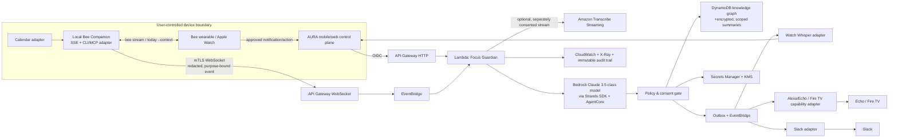

# Project AURA — Production Architecture

## Architecture intent

AURA is an event-driven, privacy-minimized orchestration system. Bee stays the owner’s primary memory surface. AURA’s local companion is the only component allowed to access Bee’s full context; the cloud receives a short-lived, redacted context envelope only for a user-approved purpose.



The diagram shows the requested components. Two important production corrections are intentional:

1. **Amazon Transcribe is an optional alternate input, not required for Bee.** Bee’s stated design transcribes in real time and discards audio, so AURA must not recreate an audio archive.
2. **The LLM cannot call Alexa, Fire TV, or Slack directly.** It returns proposed structured actions. The policy/consent gate determines whether an action can be requested or executed.

## Component responsibilities

| Component | Responsibility | Data boundary |
|---|---|---|
| Local Bee Companion | Authenticates with official Bee CLI; reads SSE/calendar context; strips raw text to approved summary evidence; relays signed events. | Full Bee content remains local unless the user authorizes selected data. |
| API Gateway + Lambda | Validates JWT/device binding, schema, rate limits, event IDs; drives orchestrations. | No raw audio accepted by default. |
| EventBridge + SQS DLQ | Durable event routing, retries, scheduled T-5 triggers, replay-safe fanout. | Payload references and minimized envelopes, not transcript blobs. |
| Bedrock + Strands + AgentCore | Produces constrained pre-briefing/detection proposal with citations and confidence. AgentCore provides managed production runtime, identity, tools, memory, and observability capabilities. | Model context is redacted, purpose-bound, logged only as privacy-safe metadata. |
| DynamoDB knowledge graph | Stores nodes (event, topic, project, commitment) and edges (discussed-with, blocked-by, follows-up) in single-table adjacency model. | Tenant/user partition and KMS encryption; TTL for ephemeral states. |
| Consent and policy service | Holds grants, scopes, target allowlists, action risk tier, and kill switches; creates an immutable decision/audit record. | Separate from agent reasoning; deterministic. |
| Capability adapters | Watch/mobile notification; Alexa/Echo/Fire TV; Slack. Each declares supported actions and scopes. | OAuth/device tokens reside in Secrets Manager; action payloads are minimum necessary. |

AWS references: [AgentCore overview](https://docs.aws.amazon.com/bedrock-agentcore/), [AgentCore with Strands](https://docs.aws.amazon.com/bedrock-agentcore/latest/devguide/code-interpreter-using-strands.html), [AgentCore capabilities](https://aws.amazon.com/bedrock/agentcore/faqs/), [Transcribe streaming](https://docs.aws.amazon.com/transcribe/latest/dg/streaming.html), [Slack `chat.postMessage`](https://api.slack.com/methods/chat.postMessage).

## Flow 1 — Pre-Meeting Intelligence

1. Calendar adapter creates/updates a normalized event. EventBridge Scheduler emits `meeting.prep.requested` at T-5, idempotency key `{user}:{calendarEventId}:{startEpoch}`.
2. Local companion obtains only consented Bee evidence: latest relevant approved memories, open commitments, and user preferences. It redacts PII/sensitive categories locally and sends an envelope—not transcript history.
3. Lambda invokes the agent with a strict schema. The agent proposes a 40–70 word summary, exactly three questions, emotion/tone, confidence, and evidence IDs. It must say “insufficient context” when appropriate.
4. Policy service checks event eligibility, consent, quiet hours, source classification, and watch adapter availability. No meeting content is sent to Slack.
5. Whisper adapter delivers an actionable card: “Read,” “Save,” “Not useful,” “Mute this event series.” The device may fall back to mobile notification.
6. Feedback becomes a per-user preference signal. It never retrains a shared model without separate, explicit research consent.

## Flow 2 — Focus Guardian

1. User starts a focus session or says/types “I’m distracted.” This explicit signal is the highest-confidence trigger. Optional local signals (for example an app-level YouTube focus policy) are enabled one by one—not inferred from a general phone-unlock feed.
2. Local companion emits a minimized `focus.signal` with signal type, timestamp, session ID, and consent policy. It does not send browsing history, audio, or raw screen content.
3. Lambda uses a transparent, decaying score and agent classification to propose `none`, `nudge`, `request_dnd`, `request_pause`, or `end_focus`. It returns structured JSON only.
4. Deterministic policy checks grant scope, rate limit, household/device allowlist, action tier, and whether the device confirms support. High-impact / unsupported operations become a confirmation request.
5. Adapter runs only the permitted command, writes an idempotent outbox receipt, and exposes Undo. Example: a verified Fire TV transport-control capability may pause; Alexa DND/Fire TV integrations must be certified and supported for the connected account. [Fire TV Media Session reference](https://developer.amazon.com/docs/fire-tv/mediasession-api-integration.html)
6. Deep Work Bank receives a private, explainable point event. Slack can publish only an opted-in availability card, with expiry. `chat:write` is required to post. [Slack reference](https://api.slack.com/methods/chat.postMessage)

## Always-on pattern: lessons adapted, not copied

[macsiah/bee-agent](https://github.com/macsiah/bee-agent) is a useful architectural reference: it runs `bee_monitor.py` continuously, consumes `bee stream --json`, retains a bounded live cache, routes finalized content, and exposes a hybrid MCP server. Its README describes `bee_classifier.py` and 26 MCP tools/6 resources. AURA uses the **pattern**—supervised local worker + bounded buffers + event typing + graceful reconnect—not its code or its broad transcript persistence.

Production adaptations:

- Run a per-user local service under the OS service manager (Windows Service/LaunchAgent/systemd) with exponential reconnect, signed config, health endpoint, and no plaintext token logs.
- Bound memory and use local encrypted SQLite queue/outbox; purge event bodies after acknowledged relay.
- Prefer consented, purpose-specific envelope creation over a general markdown knowledge base.
- Use an outbox/idempotency model for cloud fanout. Never execute remote actions from raw stream text.

[brookejamieson/reinvent-notetaker](https://github.com/brookejamieson/reinvent-notetaker) demonstrates the complementary pattern of Bee capture plus a Strands agent and AWS knowledge tooling to turn material into researched notes. AURA borrows the separation of capture and reasoning, but uses short pre-meeting context, structured output, and a policy gate rather than post-event note generation.

## The Model-to-Policy Boundary: Deterministic Gatekeeping

A core architectural invariant of Project AURA is the strict separation between probabilistic generative models and deterministic system actuation.

```
┌────────────────────────────────────────────────────────────────────────────────────────┐
│                        MODEL PROPOSAL vs. POLICY EXECUTION                             │
├────────────────────────────────────────────────────────────────────────────────────────┤
│                                                                                        │
│   Probabilistic Intelligence Tier (AWS Bedrock / IBM Watsonx)                          │
│   • Input: Minimized, PII-scrubbed context envelope (max 5 evidence items).            │
│   • Output: Strictly validated JSON schema (FocusProposal).                            │
│   • Non-Negotiable Invariant: Returns policy_required: true.                           │
│   • Authority: ZERO execution capability. Models cannot invoke device APIs.            │
│                                      │                                                 │
│                                      ▼                                                 │
│   Anti-Hallucination Evidence Guard (lambda/focus_guardian.py)                         │
│   • Verifies: proposed_evidence_ids ⊆ input_evidence_ids.                              │
│   • Violation: Immediate discard -> safe_fallback(reason="hallucinated_evidence").     │
│                                      │                                                 │
│                                      ▼                                                 │
│   Deterministic Policy Gatekeeper (standalone_agent/policy_engine.py)                  │
│   • Grant Verification: Explicit user consent (Ask every time, This session, Always).  │
│   • Device Allowlist: Explicit hardware ID matching in user's household partition.     │
│   • Undo Rate Guardrail: Circuit breaker trips if 30-day undo rate exceeds 5%.         │
│   • Actuation: Issues single-use Undo Token and dispatches to capability adapter.      │
│                                                                                        │
└────────────────────────────────────────────────────────────────────────────────────────┘
```

### Adapter Readiness & Integration Boundaries

To maintain technical transparency across portfolio evaluation:

| Adapter / Target | Readiness Tier | Verified In-Repo Evidence | Requirements for Live Physical Execution |
|---|---|---|---|
| **Focus Guardian Engine** | **Implemented** | `lambda/focus_guardian.py`, `tests/unit/test_focus_guardian.py` | None (fully autonomous serverless handler). |
| **Cognito RS256 Auth Gate** | **Implemented** | `lambda/auth.py`, `tests/unit/test_auth_enforcement.py` | Amazon Cognito User Pool ARN. |
| **Durable DynamoDB Undo Machine** | **Implemented** | `lambda/control_plane.py`, `tests/unit/test_durable_undo_statemachine.py` | DynamoDB Table (`AuraCoreTable`). |
| **Resilience Gateway (Dual-LLM)** | **Implemented** | `lambda/resilience_gateway.py`, `tests/unit/test_resilience_gateway.py` | AWS Bedrock and/or IBM Watsonx API keys. |
| **Client-Side Redactor** | **Implemented** | `standalone_agent/redactor.py`, `tests/unit/test_redactor.py` | None (local regex execution). |
| **Amazon Fire TV Adapter** | **Simulated / Adapter Staged** | `lambda/control_plane.py`, `tests/unit/test_device_adapter.py` | Physical Fire TV on local subnet supporting `MediaSession` v2. |
| **Amazon Echo / Alexa Adapter** | **Simulated / Adapter Staged** | `lambda/control_plane.py`, `tests/unit/test_device_adapter.py` | Alexa Smart Home Skill & certified household authorization. |
| **Smart Lighting & AC Adapters** | **Simulated / Adapter Staged** | `lambda/control_plane.py`, `tests/unit/test_device_adapter.py` | Philips Hue Bridge or Home Assistant / Ecobee REST API. |
| **Slack Status Adapter** | **Prototype (Contract Tested)** | `lambda/control_plane.py`, `tests/unit/test_slack_adapter.py` | Slack App with `chat:write` / `users.profile:write` OAuth tokens. |
| **Apple Push Notification (APNs)** | **Prototype (Contract Tested)** | `lambda/apns_dispatcher.py`, `tests/contract/test_apns_dispatcher_contract.py` | Apple Developer Team Certificate (.p8) & APNs topic. |

---

## Edge Case & Failure Recovery Pathways

AURA is engineered to fail closed and preserve user agency during disruptions:

1. **Insufficient Evidence ($T-5$ Context Gap):**
   - If fewer than 1 relevant memory is available, the system immediately returns `safe_fallback(fallback_reason="insufficient_context")` rather than generating speculative briefing questions.
2. **Fabricated Citations (Model Hallucination):**
   - If the model returns evidence IDs absent from the input request, the output is intercepted before reaching the user and replaced with a deterministic fallback (`hallucinated_evidence`).
3. **Provider Outage / Throttling:**
   - Bedrock timeouts (>8.0s) or HTTP 429/5xx trigger automatic circuit-breaker failover to Watsonx (12.0s deadline). If Watsonx also fails, the system executes a zero-compute local heuristic briefing.
4. **Offline Device or Rollback Failure:**
   - If an undo request cannot reach a physical device (e.g., Fire TV is offline), the handler returns `502 Bad Gateway` with `retryable: true`, leaving the single-use token unconsumed.

---

## Data model and retention

| Entity | Keys | Retention |
|---|---|---|
| ConsentGrant | `TENANT#…#USER#…`, `GRANT#…` | Until revoked + compliance audit policy; revocation cache invalidated in <60 seconds. |
| MeetingContext | user/event/version | Default 24 h TTL; source evidence IDs only after delivery. |
| GraphEdge | user graph partition + entity adjacency | User-configurable; derived summary only; no raw audio. |
| FocusSession | user/session | 30 days default; user-deletable. |
| ActionAudit | tenant/user/action | 90 days default, immutable and minimized. |
| SlackStatus | workspace/user/expiry | TTL at expiry; payload has no meeting content. |

## Operational topology

- Regional cells isolate tenants and minimize blast radius. Global control plane stores no conversation content.
- DynamoDB global tables are off by default; enable only with documented residency and encryption review.
- WebSocket connection state in DynamoDB with TTL; EventBridge archives retain privacy-safe event metadata only.
- SQS DLQ, CloudWatch alarms, X-Ray traces, OpenTelemetry correlation IDs, and synthetic canaries cover trigger-to-delivery.
- Feature flags progressively enable adapters and model versions; every action capability has a tenant, user, and global kill switch.

---

**Author / Architect:** Aditya Shinde  
*Project AURA · All Rights Reserved*
