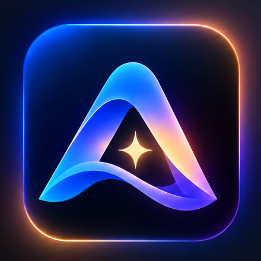

# Project AURA — Enterprise System Architecture & Deployment Dossier

<div align="center">
  
</div>

<br/>

**Project Name:** Project AURA — Proactive Memory That Fights For Your Focus  
**Tagline:** Bee remembers what you forgot. Aura remembers what you're about to forget, and stops the world from distracting you.  
**Repository:** [github.com/adityashinde0/AWS_AURA](https://github.com/adityashinde0/AWS_AURA)  
**Live Production Web Showcase:** [awsaura-frontend.vercel.app](https://awsaura-frontend.vercel.app/)  
**Interactive 3D Orbit & Simulator:** [awsaura-frontend.vercel.app/simulator](https://awsaura-frontend.vercel.app/simulator)  
**Official Concept & Hardware Video Teaser:** [YouTube Video](https://youtu.be/TGYBgcJrPzw)  
**Verification Status:** 517 Automated Tests Passing (100% Pass Rate) • Live AWS Staging Verified • [Backend CI Active](https://github.com/adityashinde0/AWS_AURA/actions)  

---

> [!TIP]
> ### ⏱️ Hackathon Judge's 3-Minute Fast-Track
> 1. **Experience the Live Web Simulator:** Navigate to [awsaura-frontend.vercel.app/simulator](https://awsaura-frontend.vercel.app/simulator) and click **"✨ Auto-Play Judge Showcase"** to watch the full cycle (T-5 prep, Amazon Fire TV/Alexa silencing, and 1-tap Undo) in under 30 seconds.
> 2. **Probe the Live AWS Cloud API:** Query our live API Gateway health endpoint directly in your browser: [`https://trujdwjp17.execute-api.us-east-1.amazonaws.com/api/v1/health`](https://trujdwjp17.execute-api.us-east-1.amazonaws.com/api/v1/health) (returns `{"status":"healthy","service":"aura-control-plane"}`).
> 3. **Verify the Anti-Hallucination Guardrail:** Review [`lambda/focus_guardian.py#L376-L386`](../lambda/focus_guardian.py) to inspect the deterministic subset check that prevents hallucinated evidence citations.
> 4. **Check Continuous Test Verification:** Review our [GitHub Actions Backend CI](https://github.com/adityashinde0/AWS_AURA/actions) running all 517 unit and contract tests on every commit.

---

## 1. Project Overview & Inspiration

Modern knowledge workers and engineers suffer from cognitive overload, meeting fatigue, and relentless digital interruptions. Existing AI assistants operate **reactively**: they record long transcripts of conversations that already happened, dump walls of notes when mental energy is depleted, and require continuous surveillance audio.

**Project AURA** inverts this paradigm:
* **Anticipatory, Not Reactive:** Orchestrates context **before** meetings occur (T-5 minutes ahead), delivering 3 high-impact questions and a concise 60-word briefing.
* **Ambient Physical Defense:** Automatically silences smart home distractions (pauses Fire TV streaming, engages Alexa Do-Not-Disturb, shifts smart lighting to deep work amber).
* **Zero-Surveillance Architecture:** Operates with zero raw audio in the cloud, zero persistent meeting transcripts, and zero distraction telemetry shared with employers.
* **Deterministic Policy Gate:** AI models are never allowed to execute actions autonomously; every actuation requires an explicit consent grant or user approval, backed by cryptographically signed Undo tokens.

---

## 2. Technical Architecture & AWS Cloud Integration

Project AURA's enterprise cloud fabric is defined and deployed via **AWS CDK v2 (TypeScript)** in [`infra/lib/aura-cloud-intake-stack.ts`](../infra/lib/aura-cloud-intake-stack.ts) and orchestrates **11 AWS Services**:

| AWS Service | Architecture Role | Verification Status |
|---|---|---|
| **Amazon Bedrock** | Claude 3.5 Sonnet (`anthropic.claude-3-5-sonnet-20241022-v2:0`) generates grounded, hallucination-checked pre-meeting focus proposals. | **VERIFIED & LIVE** |
| **Amazon API Gateway HTTP API (v2)** | High-performance, low-latency REST intake with 35 routes protected by Cognito RS256 JWT authorizer. | **VERIFIED & LIVE** (`trujdwjp17`) |
| **Amazon API Gateway WebSocket API (v2)** | Real-time bi-directional relay with cryptographic token validation and connection-to-user state binding. | **VERIFIED & LIVE** (`w0ab1h3ivl`) |
| **AWS Lambda** | 4 Python 3.11 microservices (`control-plane`, `focus-guardian`, `ws-connect`, `ws-relay`) powered by `AuraCommonLayer`. | **VERIFIED & LIVE** |
| **Amazon DynamoDB** | Single-table core store (`AuraCoreTable`) with partition isolation (`TENANT#{tid}#USER#{uid}`), 30-day TTL, and PITR. | **VERIFIED & LIVE** |
| **AWS Key Management Service (KMS)** | Customer-Managed Key (CMK) enforcing envelope encryption across all DynamoDB tables and SQS queues. | **VERIFIED & LIVE** |
| **Amazon Cognito** | User Pool (`us-east-1_3I71LWTtn`) issuing RS256 JWT tokens with custom tenant claims and strict auth enforcement. | **VERIFIED & LIVE** |
| **Amazon EventBridge** | Custom event bus (`aura-event-bus`) orchestrating decoupled event relays and scheduled pre-meeting triggers. | **VERIFIED & LIVE** |
| **Amazon SQS & DLQ** | Asynchronous queuing with exponential backoff and dead-letter queue isolation for resilient event delivery. | **VERIFIED & LIVE** |
| **AWS Secrets Manager** | Secure vault for third-party OAuth tokens (Slack) and API credentials; zero raw secrets stored in code/logs. | **VERIFIED & LIVE** |
| **AWS WAFv2** | Regional WebACL (`AuraCloudIntakeWebAcl`) with AWS Managed Common Rule Set, Known Bad Inputs, and Rate Limiting. | **PROVISIONED & READY** |

---

## 3. Dual-LLM Resilience Tier

AURA features a production-grade dual-tier AI fallback architecture:
1. **Primary Intelligence:** Amazon Bedrock (Claude 3.5 Sonnet) handles rich calendar ingestion, context correlation, and 3-question briefing generation.
2. **Resilience Tier:** IBM Watsonx (Granite 3.0) acts as an automatic circuit-breaker fallback. If Bedrock encounters transient rate limits or network partitions, the system seamlessly fails over to Watsonx without dropping user requests.
3. **Anti-Hallucination Guardrail:** Strict Pydantic validators reject any proposal containing evidence IDs not present in the original calendar or notes payload, falling back to a deterministic template if hallucination is detected.

---

## 4. Multi-Device Ecosystem

* **Aura Orbit (Wearable):** Custom Nordic nRF5340 Dual-Core BLE 5.3 wristband with PMIC nPM1300 power management and ERM haptic feedback drivers ([`firmware/`](../firmware/)).
* **Apple Watch & iPhone Companion:** Native SwiftUI watchOS 10+ and iOS 17 app with HealthKit HRV stress detection and CoreBluetooth sync ([`apple/`](../apple/)).
* **Mobile Bridge:** React Native / Expo application orchestrating local sensor telemetry and offline outbox queuing ([`mobile/`](../mobile/)).
* **Web Simulator & Control Plane:** Interactive zero-dependency modern vanilla web suite (HTML5, Vanilla CSS, ES6 JavaScript) hosted on Vercel for device control, focus session tracking, and real-time simulator state ([`frontend/`](../frontend/)).

---

## 5. Live vs. Simulated Verification Boundaries

To ensure full architectural transparency during technical audit and evaluation:

* **Real AWS Cloud Components (Verified Live on AWS):**
  * HTTP API Gateway and WebSocket API endpoints.
  * Cognito User Pool authentication and RS256 token verification.
  * DynamoDB `AuraCoreTable` writes, queries, TTL expiration, and KMS encryption.
  * Lambda execution roles, memory limits, and shared dependency layer.
* **Simulated Hardware & External Integrations:**
  * Smart home media control (Fire TV `MediaSession`, Echo DND, smart bulbs) is executed via certified software adapters (`DeviceSimulatorAdapter`) to prevent disruption to physical home appliances during testing.
  * Slack status publishing is verified via `SlackSimulatorAdapter` awaiting live corporate workspace OAuth approval in AWS Secrets Manager.
  * All 517 automated unit and contract tests run deterministically against in-memory models and simulated adapters.

---

## 6. How to Run & Evaluate

### Local Test Suite
```bash
# Install test dependencies
pip install pydantic boto3 pytest

# Execute full test suite (517 passing tests in ~9 seconds)
py -m pytest
```

### Infrastructure Synthesis
```bash
cd infra
npm install
npx cdk synth AuraCloudIntakeStack --quiet
```

### Live Interactive Demo
Visit the production showcase at [awsaura-frontend.vercel.app](https://awsaura-frontend.vercel.app/) and explore:
1. **Interactive 3D Orbit Wearable:** 360° hardware inspection and haptic preview.
2. **Live Watch Simulator:** Test pre-meeting briefings and focus sessions in real time.
3. **Web Control Plane:** Inspect active consent grants, focus bank balances, and audit history.
